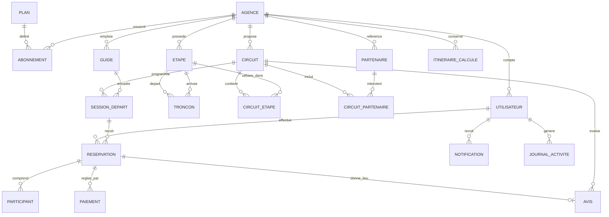
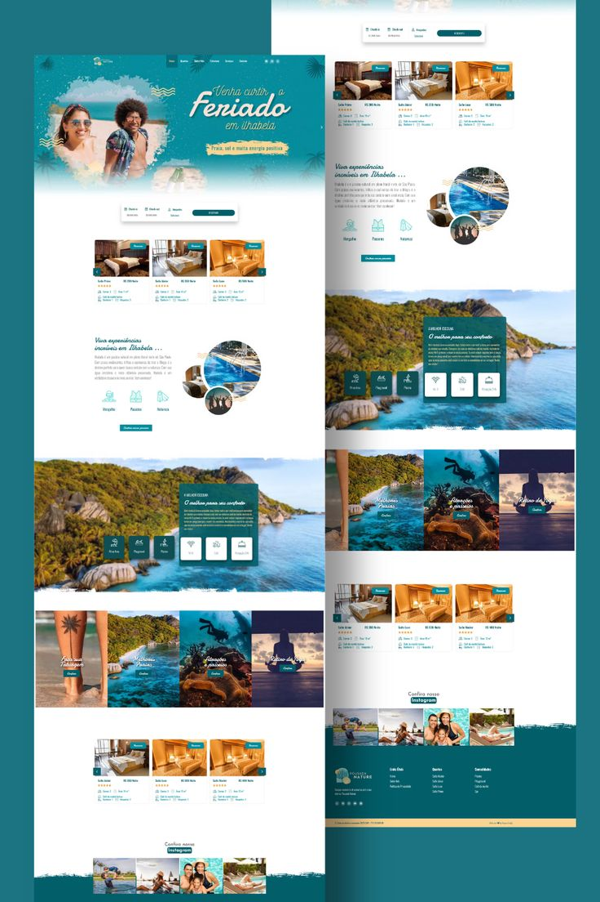

# Cahier des charges — Plateforme SaaS Green Trek

Version 1.0 · Projet de fin d'études, Master 2, ENI Fianarantsoa

**Thème du mémoire :** _Conception et réalisation d'une plateforme SaaS de gestion et de réservation pour agences de voyage, intégrant l'optimisation d'itinéraires par algorithmes de plus court chemin : cas de Green Trek Mada._

---

## 1. Contexte et objectifs

### 1.1 Contexte

Green Trek Mada est une agence de voyage spécialisée en écotourisme, basée à Mahambo (district de Fénérive-Est, côte Est de Madagascar). Elle conçoit et commercialise des circuits de randonnée reliant des villages, avec des partenaires locaux (hébergement, restauration, activités nautiques, piroguiers). Elle ne dispose d'aucun outil numérique de gestion.

### 1.2 Objectif général

Concevoir et développer une plateforme **SaaS multi-agences** : chaque agence de voyage gère ses circuits, ses départs, ses réservations et ses clients dans un espace isolé, et dispose d'un site vitrine public. Green Trek Mada est la première agence cliente.

### 1.3 Objectifs spécifiques

1. Permettre aux visiteurs de consulter les circuits d'une agence et de réserver en ligne.
2. Fournir au personnel de l'agence un back-office complet (circuits, départs, clients, réservations, paiements, guides, partenaires).
3. Modéliser le réseau de villages et de sentiers comme un **graphe pondéré** et calculer des itinéraires optimaux (Dijkstra, A*) : c'est le **cœur technique** du mémoire.
4. Garantir l'**isolation des données** entre agences (architecture multi-tenant).
5. Fournir une couche d'administration SaaS (plans, abonnements simulés, supervision des agences).

### 1.4 Cadre du projet

- Démonstration **locale** pour la soutenance : pas de mise en production publique.
- Paiements, e-mails et abonnements **simulés** (aucune intégration réelle).
- Durée restante : environ 1 mois pour le code et le mémoire. Le développement est guidé pas à pas par Claude Code.
- Principe directeur : **mieux vaut 15 tables solides et testées que 19 bancales.** Le mémoire ne décrit que ce qui est réellement implémenté.

---

## 2. Périmètre et priorités

| Priorité | Signification                   | Contenu                                                                                                                        |
| -------- | ------------------------------- | ------------------------------------------------------------------------------------------------------------------------------ |
| **P0**   | Indispensable pour la démo      | Multi-tenant, auth, circuits, étapes, tronçons, algorithme, sessions de départ, site vitrine, réservation                      |
| **P1**   | Important si le temps le permet | Guides, partenaires, participants, paiement simulé, plans et abonnements, historique des calculs d'itinéraires, dashboard KPIs |
| **P2**   | Bonus                           | Avis, notifications, journal d'activité, exports CSV, thème par agence, sous-domaines, FR/EN                                   |

**Hors périmètre :** vrais paiements (Mvola, Orange Money, Airtel Money, carte), envoi réel d'e-mails/SMS, application mobile native, déploiement public, facturation réelle des abonnements.

---

## 3. Acteurs et permissions

| Rôle           | Description                               | Portée                                                            |
| -------------- | ----------------------------------------- | ----------------------------------------------------------------- |
| `SUPER_ADMIN`  | Administrateur de la plateforme SaaS      | Toutes les agences (lecture, suspension), plans                   |
| `ADMIN_AGENCE` | Propriétaire / responsable d'une agence   | Toute son agence + paramètres + abonnement                        |
| `STAFF`        | Personnel de l'agence                     | Circuits, départs, réservations, clients, paiements de son agence |
| `GUIDE`        | Guide de l'agence                         | Ses départs et la liste de ses participants (lecture)             |
| `CLIENT`       | Voyageur inscrit sur le site d'une agence | Son profil, ses réservations, ses avis                            |

Matrice résumée (C = créer, L = lire, M = modifier, S = supprimer) :

| Ressource                  | SUPER_ADMIN | ADMIN_AGENCE                  | STAFF      | GUIDE           | CLIENT                         |
| -------------------------- | ----------- | ----------------------------- | ---------- | --------------- | ------------------------------ |
| Agences, plans             | CLMS        | L (la sienne), M (paramètres) | –          | –               | –                              |
| Utilisateurs de l'agence   | L           | CLMS                          | L          | –               | –                              |
| Circuits, étapes, tronçons | L           | CLMS                          | CLM        | L               | L (circuits publiés)           |
| Départs (sessions)         | L           | CLMS                          | CLM        | L (les siens)   | L (ouverts)                    |
| Réservations               | L           | CLMS                          | CLM        | L (ses départs) | C, L (les siennes), annulation |
| Paiements                  | L           | CLMS                          | CLM        | –               | L (les siens)                  |
| Avis                       | L           | modération                    | modération | –               | C, L                           |

---

## 4. Architecture SaaS multi-tenant

- **Modèle retenu :** base de données partagée, schéma partagé, discriminant `agenceId` sur chaque table métier (le _tenant_ est l'`Agence`).
- **Session :** le jeton de session contient `userId`, `role` et `agenceId`. `SUPER_ADMIN` a `agenceId = null`.
- **Helper tenant :** une fonction (par exemple `getTenantDb(agenceId)`, basée sur une extension du client Prisma) injecte automatiquement `where: { agenceId }` sur les lectures et `agenceId` sur les créations. Aucun code de page ou d'action n'utilise le client Prisma « brut » sur une table liée à une agence.
- **Tables liées à une agence :** `Utilisateur` (sauf super admin), `Guide`, `Circuit`, `Etape`, `Troncon`, `Partenaire`, `SessionDepart`, `Reservation`, `Avis`, `Notification`, `JournalActivite`, `ItineraireCalcule`, `Abonnement`. Les tables de liaison (`CircuitEtape`, `CircuitPartenaire`, `Participant`, `Paiement`) héritent de l'agence via leur parent : le helper vérifie la parenté.
- **Tests d'isolation obligatoires (Vitest) :** un `ADMIN_AGENCE` de l'agence A ne peut ni lire, ni modifier, ni supprimer une donnée de l'agence B (par identifiant direct, par liste, par relation).
- **Routage :**

| Route                              | Contenu                                                             |
| ---------------------------------- | ------------------------------------------------------------------- |
| `/`                                | Landing SaaS (présentation, atouts, CTA)                            |
| `/tarifs`                          | Plans et tarifs (fictifs)                                           |
| `/inscription-agence`              | Onboarding : création d'une agence + compte admin + période d'essai |
| `/connexion`                       | Connexion (toutes catégories d'utilisateurs)                        |
| `/a/[slug]`                        | Site vitrine public de l'agence (d'après la maquette §8)            |
| `/a/[slug]/circuits/[circuitSlug]` | Détail d'un circuit (carte, étapes, départs)                        |
| `/a/[slug]/reserver/[sessionId]`   | Tunnel de réservation                                               |
| `/a/[slug]/mon-compte`             | Espace client                                                       |
| `/dashboard/...`                   | Back-office de l'agence (rôle ADMIN_AGENCE, STAFF, GUIDE)           |
| `/admin/...`                       | Console super admin                                                 |

- **Bonus P2 :** simulation de sous-domaines en local (`greentrek.localhost`) via le middleware.

---

## 5. Modèle de données (19 tables)

### 5.1 Vue d'ensemble



### 5.2 Description des tables

| #   | Table               | Priorité | Champs clés                                                                                                                                                                                                                           | Relations et contraintes                                                                     |
| --- | ------------------- | -------- | ------------------------------------------------------------------------------------------------------------------------------------------------------------------------------------------------------------------------------------- | -------------------------------------------------------------------------------------------- |
| 1   | `Agence`            | P0       | id, nom, slug (unique), description, logoUrl, couleurPrimaire, email, telephone, adresse, ville, pays, devise (défaut `MGA`), statut (`ACTIVE`/`SUSPENDUE`), createdAt                                                                | Tenant racine                                                                                |
| 2   | `Utilisateur`       | P0       | id, agenceId (nullable pour SUPER_ADMIN), nom, prenom, email, motDePasseHash, telephone, role, actif, dernierLoginAt, createdAt                                                                                                       | unique(agenceId, email)                                                                      |
| 3   | `Circuit`           | P0       | id, agenceId, titre, slug, resume, description, difficulte, dureeJours, distanceKm (cache calculé), prixParPersonne, capaciteMax, imagePrincipaleUrl, statut (`BROUILLON`/`PUBLIE`/`ARCHIVE`), createdAt                              | unique(agenceId, slug)                                                                       |
| 4   | `Etape`             | P0       | id, agenceId, nom, description, type (`VILLAGE`, `POINT_INTERET`, `HEBERGEMENT`, `RESTAURATION`, `EMBARCADERE`, `AUTRE`), latitude, longitude, altitudeM                                                                              | **Nœud du graphe**, propre à l'agence et réutilisable entre circuits                         |
| 5   | `Troncon`           | P0       | id, agenceId, etapeDepartId, etapeArriveeId, distanceKm, dureeMinutes, deniveleM, difficulte (1 à 5), bidirectionnel, distanceEstimee (bool), commentaire                                                                             | **Arête du graphe**. unique(etapeDepartId, etapeArriveeId), départ ≠ arrivée, distanceKm > 0 |
| 6   | `CircuitEtape`      | P0       | id, circuitId, etapeId, ordre, jour, dureeSejourMin, notes                                                                                                                                                                            | unique(circuitId, ordre)                                                                     |
| 7   | `SessionDepart`     | P0       | id, agenceId, circuitId, guideId (nullable), dateDebut, dateFin, placesTotal, prixParPersonne (nullable, remplace celui du circuit), statut (`OUVERTE`/`COMPLETE`/`ANNULEE`/`TERMINEE`), notes                                        | dateFin ≥ dateDebut, placesTotal > 0. C'est l'objet « disponibilité »                        |
| 8   | `Reservation`       | P0       | id, agenceId, reference (unique), clientId (Utilisateur), sessionId, nombrePersonnes, montantTotal (prix figé à la réservation), statut (`EN_ATTENTE`/`CONFIRMEE`/`ANNULEE`/`TERMINEE`), remarques, createdAt, confirmeeAt, annuleeAt | nombrePersonnes > 0 ; anti-surbooking par transaction                                        |
| 9   | `Guide`             | P1       | id, agenceId, utilisateurId (nullable, unique), nom, prenom, telephone, bio, langues (JSON), experienceAnnees, actif                                                                                                                  | Un guide peut ne pas avoir de compte                                                         |
| 10  | `Partenaire`        | P1       | id, agenceId, nom, type (`HEBERGEMENT`, `RESTAURATION`, `ACTIVITE`, `TRANSPORT`), description, telephone, email, adresse, latitude, longitude, tarifIndicatif, actif                                                                  | Données de départ : Vanilla Café, La Pirogue Hôtel, Surf Dah Mahambo, Piroguiers Mahambo     |
| 11  | `CircuitPartenaire` | P1       | id, circuitId, partenaireId, etapeId (nullable), prestation, prixUnitaire, inclusDansPrix                                                                                                                                             | Liaison N–N                                                                                  |
| 12  | `Participant`       | P1       | id, reservationId, nom, prenom, age, nationalite, contactUrgence                                                                                                                                                                      | Données personnelles minimales                                                               |
| 13  | `Paiement`          | P1       | id, reservationId, montant, methode (`ESPECES`, `MOBILE_MONEY`, `VIREMENT`, `CARTE_SIMULEE`), statut (`EN_ATTENTE`/`VALIDE`/`ECHOUE`/`REMBOURSE`), referenceExterne, payeLe                                                           | Σ paiements valides ≤ montantTotal. **Simulé**                                               |
| 14  | `ItineraireCalcule` | P1       | id, agenceId, circuitId (nullable), etapeDepartId, etapeArriveeId, algorithme (`DIJKSTRA`/`ASTAR`), critere, alpha, beta, gamma, cheminJson, distanceTotaleKm, dureeTotaleMin, noeudsExplores, tempsCalculMs, creePar, createdAt      | Historique et matière première pour les mesures du mémoire                                   |
| 15  | `Plan`              | P1       | id, code (unique), nom, prixMensuel, maxCircuits, maxUtilisateurs, maxSessionsActives, fonctionnalites (JSON), actif                                                                                                                  | Plans fictifs : Essai, Pro, Entreprise                                                       |
| 16  | `Abonnement`        | P1       | id, agenceId, planId, dateDebut, dateFin, statut (`ESSAI`/`ACTIF`/`EXPIRE`/`ANNULE`), renouvellementAuto                                                                                                                              | Limites du plan appliquées à la création de circuits, d'utilisateurs, etc. **Simulé**        |
| 17  | `Avis`              | P2       | id, agenceId, circuitId, reservationId (unique), clientId, note (1 à 5), commentaire, statut (`EN_ATTENTE`/`PUBLIE`/`REJETE`), createdAt                                                                                              | Possible uniquement si la réservation est `TERMINEE`                                         |
| 18  | `Notification`      | P2       | id, agenceId (nullable), utilisateurId, type, titre, message, lienUrl, lue, createdAt                                                                                                                                                 | In-app uniquement                                                                            |
| 19  | `JournalActivite`   | P2       | id, agenceId (nullable), utilisateurId (nullable), action, entite, entiteId, details (JSON), createdAt                                                                                                                                | Audit des actions sensibles                                                                  |

### 5.3 Remarque de cohérence avec le mémoire

Dans la version initiale du mémoire, `Etape` appartenait à un seul circuit. Ici, `Etape` devient un **nœud réutilisable** et la table `CircuitEtape` porte l'ordre : le graphe est ainsi commun à toute l'agence, ce qui est nécessaire pour le calcul d'itinéraire. Le dictionnaire de données, les règles de gestion et les diagrammes du mémoire devront être mis à jour en conséquence.

---

## 6. Module d'optimisation d'itinéraire (cœur technique)

### 6.1 Modélisation

- **Nœuds :** les `Etape` de l'agence (latitude, longitude).
- **Arêtes :** les `Troncon`. Si `bidirectionnel = true`, l'algorithme utilise deux arcs orientés.
- **Fonction de poids :** `w(e) = α·distanceKm + β·(dureeMinutes / 60) + γ·penaliteDifficulte(e)`, avec α, β, γ ≥ 0 et w(e) > 0.
- **Préréglages de critère :** « Plus court » (α dominant), « Plus rapide » (β dominant), « Plus facile » (γ dominant). Valeurs numériques exactes à fixer par l'étudiant et à justifier dans le mémoire.
- **Distance estimée :** quand un tronçon n'a pas de mesure terrain, distance = distance de Haversine × coefficient de sinuosité configurable (hypothèse à documenter, valeur par défaut à justifier). Le champ `distanceEstimee` doit être `true` dans ce cas et l'interface doit l'indiquer.

### 6.2 Algorithmes

1. **Dijkstra** avec file de priorité (tas binaire).
2. **A\*** avec heuristique basée sur Haversine. L'heuristique doit rester **admissible** pour le critère choisi (par exemple, distance : Haversine ; durée : Haversine divisée par une vitesse maximale). Documenter la preuve d'admissibilité dans le mémoire.
3. **Étapes imposées :** trouver le meilleur itinéraire passant par un ensemble d'étapes obligatoires.
   - Ordre fixé : enchaînement de plus courts chemins.
   - Ordre libre (≤ 8 étapes) : recherche du meilleur ordre (permutations ou Held-Karp) puis enchaînement. À présenter comme une extension du problème du voyageur de commerce.

### 6.3 Sorties d'un calcul

Chemin (liste ordonnée d'étapes), distance totale, durée totale, difficulté cumulée, **nombre de nœuds explorés**, **temps de calcul (ms)**, tracé GeoJSON pour la carte. Le résultat est sauvegardé dans `ItineraireCalcule`.

### 6.4 Cas limites à traiter

Aucun chemin entre deux étapes (message clair), graphe à un seul nœud, départ = arrivée, poids nul ou négatif (rejeté à la saisie), tronçon dupliqué, étape supprimée alors qu'elle est utilisée par un tronçon ou un circuit.

### 6.5 Interface

- **Éditeur de graphe** sur carte Leaflet : ajouter une étape par clic, déplacer un marqueur, sélectionner deux étapes pour créer un tronçon (distance proposée automatiquement, modifiable), supprimer avec vérification des dépendances.
- **Page « Calculer un itinéraire » :** choix départ, arrivée, critère, algorithme ; affichage du tracé, des métriques et d'un bouton « Comparer Dijkstra et A\* » (tableau : coût, nœuds explorés, temps).
- **Page « Analyse des performances » (P1) :** benchmark sur des graphes générés aléatoirement (par exemple 50, 200, 1 000, 5 000 nœuds), graphique Recharts (temps et nœuds explorés selon la taille), résultats exportables pour le mémoire.

### 6.5 bis Tests (Vitest)

- Petit graphe de référence avec chemin optimal connu à la main.
- Dijkstra et A\* renvoient le **même coût** sur des graphes aléatoires.
- Le chemin renvoyé est continu (chaque étape est reliée à la suivante) et son coût recalculé est égal au coût annoncé.
- Cas limites du §6.4.

---

## 7. Fonctionnalités par module

### 7.1 Site vitrine public de l'agence (P0)

Basé sur la maquette (§8). Menu, hero, barre de recherche flottante (date de départ, nombre de voyageurs, difficulté), carrousel de circuits, sections de présentation, prochains départs, partenaires, avis (P2), contact, pied de page. Contenu chargé depuis la base (agence, circuits publiés, départs ouverts).
**Critères d'acceptation :** un visiteur non connecté voit uniquement les circuits `PUBLIE` de l'agence du `slug` ; la recherche filtre par date, difficulté et places disponibles ; le site est utilisable sur mobile.

### 7.2 Compte et réservation client (P0)

Inscription et connexion d'un client sur le site d'une agence ; tunnel de réservation : choix du départ → nombre de personnes → participants (P1) → récapitulatif → paiement simulé (P1) → confirmation avec référence ; page « Mes réservations » avec annulation selon règle de gestion ; avis après un séjour terminé (P2).
**Critères d'acceptation :** impossible de réserver plus de places que `placesTotal` restantes, même avec deux réservations simultanées (transaction) ; le montant est figé à la création ; un client ne voit que ses propres réservations.

### 7.3 Back-office de l'agence (P0 puis P1)

- **Tableau de bord (P1) :** réservations du mois, taux de remplissage, chiffre d'affaires simulé, prochains départs, circuits les plus réservés (Recharts).
- **Circuits :** création, modification, publication, archivage, ordonnancement des étapes, partenaires inclus.
- **Étapes et tronçons :** voir §6.5.
- **Départs :** création, affectation d'un guide (P1), statut automatique `COMPLETE` quand plus de places, annulation.
- **Réservations et clients :** liste filtrable (statut, date, circuit), fiche client avec historique, changement de statut, paiements associés.
- **Équipe :** création de comptes STAFF et GUIDE, activation/désactivation.
- **Guides, partenaires (P1).**
- **Paramètres de l'agence :** nom, logo, couleur principale (P2), coordonnées, devise.
- **Abonnement (P1) :** plan actuel et limites d'usage.

### 7.4 Console super admin (P1)

Liste des agences, suspension/réactivation, statistiques globales (nombre d'agences, de circuits, de réservations), gestion des plans, attribution d'un plan à une agence.

### 7.5 Landing SaaS et onboarding (P1)

Page de présentation de la plateforme (même identité visuelle), page tarifs, formulaire d'inscription d'agence qui crée l'`Agence`, l'`Utilisateur` ADMIN_AGENCE et un `Abonnement` en `ESSAI`.

### 7.6 Transverses (P2)

Notifications in-app, journal d'activité, exports CSV (réservations, clients), thème par agence (couleur primaire), FR/EN.

---

## 8. Design et interface

### 8.1 Maquette d'inspiration



La maquette est le site d'une _pousada_ (petit hôtel) de l'île d'Ilhabela, au Brésil. C'est une **référence visuelle tierce** : on s'inspire de la structure, de l'ambiance et de la palette, mais on **ne réutilise ni ses photos, ni ses textes, ni son logo, ni son nom**. Utiliser des photos propres de la région de Mahambo ou des images libres de droits (avec attribution si nécessaire).

### 8.2 Palette (extraite de la maquette)

Valeurs échantillonnées sur l'image (JPEG compressé) : à ajuster à l'œil si besoin.

| Token            | Hex       | Usage                                           |
| ---------------- | --------- | ----------------------------------------------- |
| `--gt-teal-500`  | `#0D8495` | Couleur principale (hero, liens, grands aplats) |
| `--gt-teal-400`  | `#068C9E` | Rubans « Réserver », badges                     |
| `--gt-teal-600`  | `#1C7482` | Dégradés, bordures du hero                      |
| `--gt-teal-700`  | `#0F6775` | **Boutons avec texte blanc**, titres            |
| `--gt-teal-800`  | `#025E69` | Pied de page                                    |
| `--gt-teal-900`  | `#0F414D` | Texte sombre, calques                           |
| `--gt-teal-card` | `#10585B` | Carte superposée à la grande photo              |
| `--gt-sand-300`  | `#FAD594` | Bande basse, accents secondaires                |
| `--gt-sand-200`  | `#EFD7A3` | Badge de slogan                                 |
| `--gt-cream`     | `#EFE8DD` | Titres script sur fond teal                     |
| `--gt-mist`      | `#D1D9DA` | Bordures, fonds neutres                         |
| `--gt-sky`       | `#96BECA` | Fonds doux, illustrations                       |
| `--gt-white`     | `#FFFFFF` | Fonds, cartes                                   |

**Accessibilité :** le blanc sur `#0D8495` donne un contraste d'environ 4,4:1, à la limite pour du petit texte. Pour les boutons et textes blancs, utiliser `#0F6775` ou plus foncé (environ 6,5:1). Vérifier tous les contrastes avec un outil dédié.

Exemple de tokens (à adapter au thème Tailwind) :

```css
:root {
  --gt-teal-500: #0d8495;
  --gt-teal-400: #068c9e;
  --gt-teal-600: #1c7482;
  --gt-teal-700: #0f6775;
  --gt-teal-800: #025e69;
  --gt-teal-900: #0f414d;
  --gt-teal-card: #10585b;
  --gt-sand-300: #fad594;
  --gt-sand-200: #efd7a3;
  --gt-cream: #efe8dd;
  --gt-mist: #d1d9da;
  --gt-sky: #96beca;
  --gt-white: #ffffff;
}
```

### 8.3 Typographie (indicative, à valider visuellement)

Police **script** manuscrite pour les accroches (par exemple Kaushan Script), police **sans-serif** lisible pour l'interface et le texte (par exemple Poppins ou Inter). Titres en script uniquement pour le hero et quelques titres de section, jamais pour les tableaux et formulaires.

### 8.4 Correspondance section par section (de haut en bas de la maquette)

| #   | Section de la maquette                                                                            | Adaptation Green Trek                                                                                                                 |
| --- | ------------------------------------------------------------------------------------------------- | ------------------------------------------------------------------------------------------------------------------------------------- |
| 1   | Menu : logo, liens, icônes réseaux sociaux                                                        | Logo agence, liens (Circuits, Expériences, Partenaires, Avis, Contact), bouton Connexion                                              |
| 2   | Hero : grande photo avec bord « coup de pinceau », accroche script crème, badge sable avec slogan | Photo de sentier ou de côte, accroche script, badge avec slogan de l'agence ; flèches de carrousel                                    |
| 3   | Barre de réservation flottante (carte blanche, ombre douce, bouton teal foncé)                    | Date de départ, nombre de voyageurs, difficulté, bouton « Rechercher »                                                                |
| 4   | Carrousel de 3 cartes de chambres : photo, ruban « Réserver », nom, étoiles, prix, pictogrammes   | Cartes de circuits : photo, ruban « Réserver », titre, étoiles (P2), « à partir de X Ar / pers », durée, distance, difficulté, places |
| 5   | Titre script + paragraphe + 3 pictogrammes + bouton ; collage d'images rondes à droite            | « Vivre Madagascar autrement » : Randonnée, Pirogue, Immersion au village                                                             |
| 6   | Grande photo plein cadre avec carte teal sombre et grille de tuiles-icônes                        | « Le meilleur pour votre aventure » : Guide local, Hébergement, Repas ruraux, Pirogue, Sécurité, Petits groupes                       |
| 7   | Rangée de 4 tuiles photo avec bouton                                                              | Sentiers, Rivière et pirogue, Villages, Actions écologiques                                                                           |
| 8   | Deuxième carrousel de cartes                                                                      | Prochains départs ouverts                                                                                                             |
| 9   | Galerie « Suivez-nous » de 4 photos                                                               | Galerie réseaux sociaux (liens statiques)                                                                                             |
| 10  | Pied de page teal sombre (logo, liens, catégories) + bande sable                                  | Liens utiles, circuits, contact ; bande sable avec mention légale                                                                     |

Traits de style à reprendre : bords de sections en **coup de pinceau blanc** (masque SVG), cartes arrondies à ombre douce, pictogrammes fins monochromes teal, alternance fonds blancs et fonds photo, boutons arrondis.

### 8.5 Interactions

Survol de carte (légère élévation), en-tête qui se réduit au défilement, squelettes de chargement, animations discrètes désactivées si `prefers-reduced-motion`. **Mobile d'abord** : la majorité des visiteurs consulteront depuis un téléphone.

### 8.6 Back-office

Interface sobre : barre latérale, tableaux avec filtres et pagination, formulaires validés, mêmes tokens de couleur. Priorité à la lisibilité plutôt qu'à la décoration.

---

## 9. Stack technique et structure

| Domaine                   | Choix                                                                                                                             |
| ------------------------- | --------------------------------------------------------------------------------------------------------------------------------- |
| Framework                 | Next.js (App Router), TypeScript strict. Utiliser la dernière version stable et vérifier la documentation de la version installée |
| Base de données           | MySQL, ORM Prisma (migrations, seed)                                                                                              |
| Authentification          | Auth.js (Credentials : e-mail et mot de passe), rôle et `agenceId` dans la session, mots de passe hachés (bcrypt ou argon2)       |
| UI                        | Tailwind CSS, composants accessibles (shadcn/ui possible)                                                                         |
| Formulaires et validation | React Hook Form + Zod                                                                                                             |
| Cartographie              | Leaflet / react-leaflet + tuiles OpenStreetMap (gratuit, sans carte bancaire). Import dynamique côté client uniquement            |
| Graphiques                | Recharts                                                                                                                          |
| Tests                     | Vitest (unitaires, isolation tenant) ; Playwright (P2)                                                                            |
| Qualité                   | ESLint, Prettier, typecheck en intégration                                                                                        |
| Environnement             | MySQL local ou Docker Compose ; variables dans `.env`                                                                             |

Structure indicative :

```
greentrek-saas/
├── CLAUDE.md
├── docs/ (CAHIER_DES_CHARGES.md, AVANCEMENT.md, design/)
├── prisma/ (schema.prisma, seed.ts, migrations/)
├── src/
│   ├── app/ (marketing, a/[slug], dashboard, admin, api)
│   ├── components/
│   ├── lib/
│   │   ├── graph/ (haversine.ts, dijkstra.ts, astar.ts, waypoints.ts, benchmark.ts)
│   │   ├── tenant.ts, auth.ts, permissions.ts, validators/
│   └── styles/tokens.css
└── tests/
```

---

## 10. Plan de réalisation par étapes

Chaque étape se termine par : typecheck, lint, tests et build au vert, mise à jour de `docs/AVANCEMENT.md`, et **confirmation de l'étudiant** avant de passer à la suivante.

| Étape   | Objectif                                                                                                                                            | Tables concernées                      | Définition de « terminé »                                                      |
| ------- | --------------------------------------------------------------------------------------------------------------------------------------------------- | -------------------------------------- | ------------------------------------------------------------------------------ |
| **E0**  | Initialisation : projet Next.js, TypeScript, Tailwind, ESLint, Prisma, MySQL, `.env.example`, `docs/AVANCEMENT.md`                                  | –                                      | Le projet démarre, la connexion MySQL fonctionne                               |
| **E1**  | Schéma Prisma complet (19 tables), migrations, seed minimal, schéma ERD                                                                             | Toutes                                 | `prisma migrate` réussi, ERD exporté pour le mémoire                           |
| **E2**  | Authentification, RBAC, helper tenant, onboarding d'agence                                                                                          | Agence, Utilisateur                    | Connexion par rôle ; **tests d'isolation verts**                               |
| **E3**  | Fondations back-office : layout, équipe, paramètres, partenaires, guides                                                                            | Utilisateur, Guide, Partenaire, Agence | CRUD fonctionnels, permissions respectées                                      |
| **E4**  | Circuits et étapes (carte)                                                                                                                          | Circuit, Etape, CircuitEtape           | Créer un circuit, placer des étapes, les ordonner                              |
| **E5**  | Éditeur de graphe (tronçons)                                                                                                                        | Troncon                                | Créer/modifier/supprimer un tronçon avec validations                           |
| **E6**  | **Algorithmes** : Dijkstra, A\*, étapes imposées, tests, UI de calcul, comparaison, benchmark                                                       | ItineraireCalcule                      | Tests verts ; tracé sur carte ; tableau comparatif ; graphiques de performance |
| **E7**  | Départs et disponibilités                                                                                                                           | SessionDepart                          | Créer un départ, affecter un guide, statut automatique                         |
| **E8**  | Site vitrine public (d'après la maquette)                                                                                                           | Circuit, SessionDepart                 | Landing conforme au §8, recherche fonctionnelle, responsive                    |
| **E9**  | Compte client et réservation, paiement simulé                                                                                                       | Reservation, Participant, Paiement     | Réservation sans surbooking, référence, « Mes réservations »                   |
| **E10** | Back-office opérationnel : réservations, clients, paiements, dashboard                                                                              | Reservation, Paiement                  | Statuts modifiables, KPIs cohérents avec les données                           |
| **E11** | Console super admin, plans et abonnements simulés, landing SaaS, tarifs                                                                             | Plan, Abonnement                       | Limites de plan appliquées ; suspension d'une agence effective                 |
| **E12** | Finition : avis, notifications, journal d'activité (selon le temps), accessibilité, seed de démonstration complet, captures d'écran, script de démo | Avis, Notification, JournalActivite    | Démo de bout en bout sans erreur                                               |

**Ordre de sécurité en cas de retard :** E0 à E9 constituent le cœur défendable. E10 à E12 s'ajoutent selon le temps. La conclusion du mémoire peut présenter le reste en perspectives.

Répartition indicative sur 4 semaines : semaine 1 (E0 à E2), semaine 2 (E3 à E6), semaine 3 (E7 à E9), semaine 4 (E10 à E12 et stabilisation). Ajuster à la réalité et **mettre à jour le chronogramme du mémoire en conséquence**.

---

## 11. Données de démonstration (seed)

- **3 agences :** Green Trek Mada (données réelles issues de sa présentation : Mahambo, sentier « Mahambo Doany – Ambodiforaha », partenaires Vanilla Café, La Pirogue Hôtel, Surf Dah Mahambo, Piroguiers Mahambo) et **2 agences fictives** clairement marquées comme fictives, pour prouver l'isolation.
- **Utilisateurs :** au moins un par rôle et par agence, avec mots de passe de démonstration documentés dans `docs/AVANCEMENT.md`.
- **Graphe de Green Trek Mada :** une douzaine d'étapes autour de Mahambo. Seules « Mahambo Doany » et « Ambodiforaha » sont connues par la présentation officielle ; les autres villages et **toutes les coordonnées GPS** doivent être marqués `TODO(données terrain)` et remplacés par des relevés réels (OpenStreetMap ou GPS de terrain) dès que possible. Les tronçons sans mesure terrain sont marqués `distanceEstimee = true`.
- **Graphe de test :** un petit graphe fixe (6 à 8 nœuds) avec résultats attendus documentés, utilisé par les tests unitaires.
- **Volumes de démonstration :** une dizaine de circuits, une vingtaine de départs, une cinquantaine de réservations aux statuts variés, pour que le dashboard soit lisible. Toutes les données personnelles sont **fictives**.

---

## 12. Exigences non fonctionnelles

- **Sécurité :** mots de passe hachés, validation Zod côté serveur sur toute entrée, contrôle de rôle et de tenant sur chaque route et action, protection CSRF fournie par le framework, aucune donnée sensible dans les journaux, limitation des tentatives de connexion (P2).
- **Données personnelles :** collecte minimale (participants), données de démonstration fictives.
- **Performance :** pagination des listes, index sur `agenceId` et sur les clés étrangères, calcul d'itinéraire en moins d'une seconde sur le graphe de démonstration.
- **Accessibilité et responsive :** mobile d'abord, contrastes conformes, navigation clavier, libellés de formulaires.
- **Fiabilité :** transactions pour la réservation et les paiements ; messages d'erreur clairs en français.
- **Hors ligne pour la démo :** les tuiles OpenStreetMap exigent Internet. Prévoir des captures d'écran et une vidéo de secours en cas de coupure.
- **Qualité du code :** TypeScript strict, ESLint, tests sur les algorithmes et l'isolation tenant, commits petits.

---

## 13. Règles de gestion (à reporter dans le mémoire)

1. Une agence possède un `slug` unique.
2. Un utilisateur appartient à une seule agence (sauf `SUPER_ADMIN`), avec un rôle unique.
3. L'adresse e-mail est unique au sein d'une agence.
4. Un circuit est composé d'au moins deux étapes, ordonnées sans doublon de rang.
5. Une étape appartient à une agence et peut être utilisée dans plusieurs circuits de cette agence.
6. Un tronçon relie deux étapes distinctes de la même agence ; sa distance est strictement positive.
7. Il ne peut exister qu'un tronçon par couple (départ, arrivée).
8. Une étape ne peut pas être supprimée si un tronçon ou un circuit l'utilise.
9. Un circuit n'est visible publiquement que s'il est `PUBLIE`.
10. Un départ appartient à un circuit ; sa date de fin est postérieure ou égale à sa date de début.
11. Un départ passe à `COMPLETE` lorsque toutes ses places sont prises.
12. Une réservation concerne un seul client et un seul départ ; le nombre de personnes est supérieur à zéro.
13. Le nombre total de personnes réservées sur un départ ne dépasse jamais `placesTotal`.
14. Le montant total est calculé à la création (prix par personne × nombre de personnes) et n'est plus modifié.
15. Une réservation n'est annulable que si le départ n'a pas commencé.
16. La somme des paiements valides ne dépasse pas le montant total.
17. Un avis n'est possible que pour une réservation `TERMINEE`, et un seul par réservation.
18. Le nombre de circuits, d'utilisateurs et de départs actifs d'une agence est limité par son plan.
19. Une agence `SUSPENDUE` n'est plus accessible au public ni à ses utilisateurs.
20. Une agence ne peut jamais lire ou modifier les données d'une autre agence.

---

## 14. Tests et scénario de démonstration

### 14.1 Scénario de soutenance (10 à 12 minutes)

1. Landing SaaS puis **inscription d'une nouvelle agence** (démonstration du multi-tenant).
2. Connexion en tant qu'admin de Green Trek Mada : tableau de bord.
3. Éditeur de graphe : étapes et tronçons sur la carte.
4. Calcul d'itinéraire : Dijkstra contre A\*, comparaison (coût, nœuds explorés, temps) et graphique de performance.
5. Création d'un départ.
6. Côté client : site vitrine, recherche, réservation, paiement simulé.
7. Retour au back-office : la réservation apparaît, confirmation.
8. **Preuve d'isolation :** l'autre agence ne voit rien de tout cela.
9. Console super admin : plans, suspension d'une agence.

### 14.2 Tests minimaux à conserver

Isolation tenant, algorithmes de graphe, anti-surbooking, règles de gestion critiques (RG 6, 13, 14, 16).

---

## 15. Livrables pour le mémoire

- ERD des tables réellement implémentées (dictionnaire de données à mettre à jour).
- Diagrammes UML à refaire dans Visual Paradigm : cas d'utilisation (5 acteurs), classes de conception par sprint et globale, séquence (réservation, calcul d'itinéraire), déploiement.
- Captures d'écran de chaque écran majeur (à lister dans `docs/AVANCEMENT.md` au fur et à mesure).
- Résultats du benchmark (tableaux et graphiques).
- Extraits de code commentés (algorithmes, helper tenant).
- Backlog produit et chronogramme **fidèles à ce qui a réellement été réalisé et quand**.

---

## 16. Hypothèses et points à valider

1. Plans et tarifs : fictifs, à définir librement.
2. Devise : Ariary (`MGA`).
3. Coefficient de sinuosité et pénalité de difficulté : valeurs à choisir et justifier.
4. Coordonnées et noms des villages du graphe : à relever sur le terrain.
5. Paiements et abonnements : simulés uniquement.
6. Présentation de Green Trek Mada comme agence de voyage : autorisée par l'entreprise. Garder une trace écrite de cette autorisation.
7. Nombre de tables final : à confirmer selon l'avancement (cible : entre 15 et 19).

## 17. Prompt de démarrage suggéré pour Claude Code

> Lis `CLAUDE.md` puis `docs/CAHIER_DES_CHARGES.md`. Ne code rien pour l'instant : résume-moi ta compréhension du projet en 10 lignes, signale les ambiguïtés ou risques que tu vois, puis propose-moi le plan détaillé de l'étape E0 et attends mon accord.
