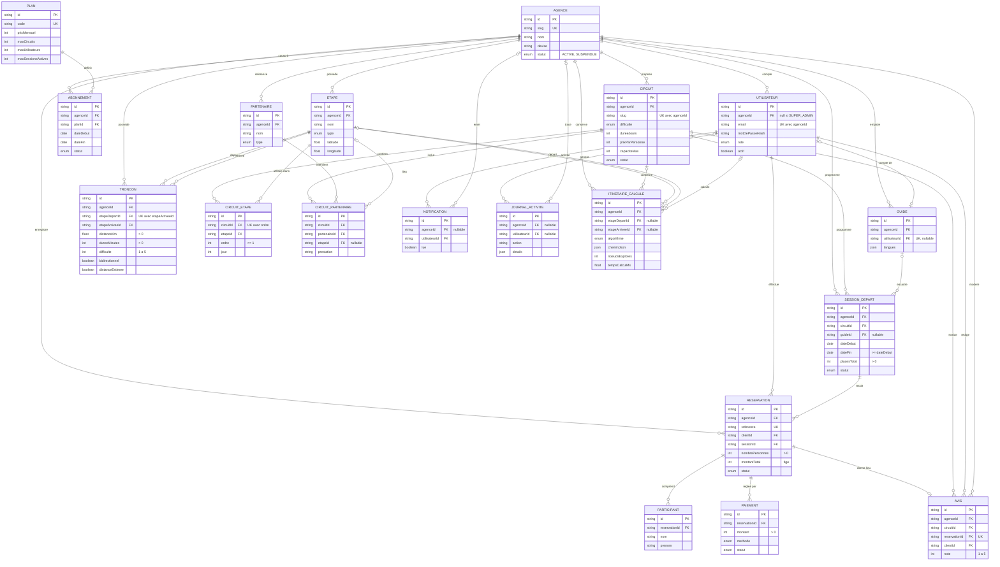

# Modèle entité-association (ERD) — Green Trek SaaS

Reflet fidèle de `prisma/schema.prisma` (migration `init`, étape E1) : 19 tables. Seuls les clés et les champs structurants sont affichés ; le détail complet est dans le schéma Prisma.

Notation : `PK` clé primaire, `FK` clé étrangère, `UK` unique. Les identifiants sont des `cuid` (texte).

**Exporter en image pour le mémoire :**
- copier le bloc `mermaid` ci-dessous dans <https://mermaid.live>, puis *Actions → PNG/SVG* ;
- ou, pour un diagramme physique complet (types, index), MySQL Workbench : *Database → Reverse Engineer…* sur la base `greentrek`.

## Écarts avec le cahier des charges §5.2 (à reporter dans le mémoire)

| Élément | Cahier des charges | Implémenté | Justification |
|---|---|---|---|
| `Circuit.difficulte` | type non précisé | enum `FACILE` / `MOYENNE` / `DIFFICILE` | Filtre de recherche simple côté vitrine ; la difficulté fine (1 à 5) reste sur les tronçons |
| `ItineraireCalcule.etapeDepartId` / `etapeArriveeId` | obligatoires | nullables (`SET NULL`) | L'historique est un instantané (`cheminJson`) : il ne doit pas empêcher la suppression d'une étape |
| `ItineraireCalcule.difficulteCumulee` | absent de la table | ajouté | Sortie exigée au §6.3 |
| `ItineraireCalcule.creePar` | `creePar` | `creeParId` (clé étrangère vers `Utilisateur`) | Convention de nommage des clés étrangères |
| `CircuitPartenaire.etapeId` | nullable | nullable, suppression de l'étape refusée | Cohérence avec RG 8 |

## Règles de gestion garanties par la base

| Règle | Mécanisme |
|---|---|
| RG 1 slug d'agence unique | index unique `Agence.slug` |
| RG 3 e-mail unique dans une agence | index unique `(agenceId, email)` |
| RG 4 rang sans doublon | index unique `(circuitId, ordre)` + CHECK `ordre >= 1` |
| RG 6 étapes distinctes, distance > 0 | CHECK `Troncon_etapes_distinctes_check`, `Troncon_distanceKm_check` |
| RG 7 un tronçon par couple | index unique `(etapeDepartId, etapeArriveeId)` |
| RG 8 étape utilisée non supprimable | clés étrangères `ON DELETE RESTRICT` (Troncon, CircuitEtape, CircuitPartenaire) |
| RG 10 fin ≥ début | CHECK `SessionDepart_dates_check` |
| RG 12 au moins une personne | CHECK `Reservation_nombrePersonnes_check` |
| RG 17 un avis par réservation | index unique `Avis.reservationId` |

Les autres règles (RG 2, 5, 6 « même agence », 9, 11, 13 à 16, 17 « réservation terminée », 18 à 20) relèvent de l'application : helper tenant, transactions, validations Zod.
