# Modèle entité-association (ERD) — Green Trek SaaS

Reflet fidèle de `prisma/schema.prisma` : 19 tables du cahier des charges (migration `init`, étape E1), plus 12 tables ajoutées après E12 à la demande de l'étudiant, soit **31 tables** :

- messagerie : `Conversation`, `Message`, `LectureConversation` ;
- compte : `JetonReinitialisation` (mot de passe oublié, invitation d'un client) ;
- application mobile : `AppareilMobile` (notifications du téléphone) ;
- itinéraires sur mesure : `ItinerairePersonnalise` ;
- voyageurs entre eux (étape 5c) : `Blocage`, `Signalement` ;
- communauté (étape 5d, tables de la **plateforme**, sans `agenceId`) : `Publication`, `Commentaire`, `Jaime`, `SignalementCommunaute`. Seuls les clés et les champs structurants sont affichés ; le détail complet est dans le schéma Prisma.

Notation : `PK` clé primaire, `FK` clé étrangère, `UK` unique. Les identifiants sont des `cuid` (texte).

**Exporter en image pour le mémoire :**
- copier le bloc `mermaid` ci-dessous dans <https://mermaid.live>, puis *Actions → PNG/SVG* ;
- ou, pour un diagramme physique complet (types, index), MySQL Workbench : *Database → Reverse Engineer…* sur la base `greentrek`.

```mermaid
erDiagram
  AGENCE ||--o{ UTILISATEUR : "compte"
  AGENCE ||--o{ ABONNEMENT : "souscrit"
  PLAN ||--o{ ABONNEMENT : "definit"
  AGENCE ||--o{ GUIDE : "emploie"
  UTILISATEUR |o--o| GUIDE : "compte de"
  AGENCE ||--o{ CIRCUIT : "propose"
  AGENCE ||--o{ ETAPE : "possede"
  AGENCE ||--o{ TRONCON : "possede"
  AGENCE ||--o{ PARTENAIRE : "reference"
  ETAPE ||--o{ TRONCON : "depart"
  ETAPE ||--o{ TRONCON : "arrivee"
  CIRCUIT ||--o{ CIRCUIT_ETAPE : "contient"
  ETAPE ||--o{ CIRCUIT_ETAPE : "utilisee dans"
  CIRCUIT ||--o{ CIRCUIT_PARTENAIRE : "inclut"
  PARTENAIRE ||--o{ CIRCUIT_PARTENAIRE : "intervient"
  ETAPE |o--o{ CIRCUIT_PARTENAIRE : "lieu"
  AGENCE ||--o{ SESSION_DEPART : "programme"
  CIRCUIT ||--o{ SESSION_DEPART : "programme"
  GUIDE |o--o{ SESSION_DEPART : "encadre"
  AGENCE ||--o{ RESERVATION : "enregistre"
  UTILISATEUR ||--o{ RESERVATION : "effectue"
  SESSION_DEPART ||--o{ RESERVATION : "recoit"
  RESERVATION ||--o{ PARTICIPANT : "comprend"
  RESERVATION ||--o{ PAIEMENT : "reglee par"
  RESERVATION ||--o| AVIS : "donne lieu"
  CIRCUIT ||--o{ AVIS : "evalue"
  UTILISATEUR ||--o{ AVIS : "redige"
  AGENCE ||--o{ AVIS : "modere"
  UTILISATEUR ||--o{ NOTIFICATION : "recoit"
  AGENCE |o--o{ NOTIFICATION : "emet"
  UTILISATEUR |o--o{ JOURNAL_ACTIVITE : "genere"
  AGENCE |o--o{ JOURNAL_ACTIVITE : "trace"
  AGENCE ||--o{ ITINERAIRE_CALCULE : "conserve"
  CIRCUIT |o--o{ ITINERAIRE_CALCULE : "concerne"
  ETAPE |o--o{ ITINERAIRE_CALCULE : "depart"
  ETAPE |o--o{ ITINERAIRE_CALCULE : "arrivee"
  UTILISATEUR |o--o{ ITINERAIRE_CALCULE : "calcule"
  AGENCE ||--o{ CONVERSATION : "echange"
  UTILISATEUR ||--o{ CONVERSATION : "client"
  RESERVATION |o--o| CONVERSATION : "concerne"
  CONVERSATION ||--o{ MESSAGE : "contient"
  UTILISATEUR ||--o{ MESSAGE : "ecrit"
  CONVERSATION ||--o{ LECTURE_CONVERSATION : "lue_par"
  UTILISATEUR ||--o{ LECTURE_CONVERSATION : "lit"
  UTILISATEUR |o--o{ CONVERSATION : "destinataire (entre voyageurs)"
  UTILISATEUR ||--o{ JETON_REINITIALISATION : "possede"
  AGENCE ||--o{ APPAREIL_MOBILE : "enregistre"
  UTILISATEUR ||--o{ APPAREIL_MOBILE : "utilise"
  AGENCE ||--o{ ITINERAIRE_PERSONNALISE : "propose"
  UTILISATEUR ||--o{ ITINERAIRE_PERSONNALISE : "client"
  UTILISATEUR ||--o{ ITINERAIRE_PERSONNALISE : "compose"
  ITINERAIRE_CALCULE ||--o{ ITINERAIRE_PERSONNALISE : "tracé"
  AGENCE ||--o{ BLOCAGE : "concerne"
  UTILISATEUR ||--o{ BLOCAGE : "bloque"
  UTILISATEUR ||--o{ BLOCAGE : "est bloqué"
  AGENCE ||--o{ SIGNALEMENT : "traite"
  UTILISATEUR ||--o{ SIGNALEMENT : "signale"
  UTILISATEUR ||--o{ PUBLICATION : "publie"
  RESERVATION ||--o{ PUBLICATION : "séjour"
  PUBLICATION ||--o{ COMMENTAIRE : "reçoit"
  UTILISATEUR ||--o{ COMMENTAIRE : "écrit"
  PUBLICATION ||--o{ JAIME : "reçoit"
  UTILISATEUR ||--o{ JAIME : "aime"
  UTILISATEUR ||--o{ SIGNALEMENT_COMMUNAUTE : "signale"

  AGENCE {
    string id PK
    string slug UK
    string nom
    string devise
    string nif "facultatif, factures"
    string stat "facultatif, factures"
    enum statut "ACTIVE, SUSPENDUE"
  }
  UTILISATEUR {
    string id PK
    string agenceId FK "null si SUPER_ADMIN"
    string email "UK avec agenceId"
    string motDePasseHash
    enum role
    boolean actif
    string photoUrl "nullable"
    datetime derniereActiviteAt "présence"
    boolean presenceVisible
    boolean messagesVoyageurs
  }
  PLAN {
    string id PK
    string code UK
    int prixMensuel
    int maxCircuits
    int maxUtilisateurs
    int maxSessionsActives
  }
  ABONNEMENT {
    string id PK
    string agenceId FK
    string planId FK
    date dateDebut
    date dateFin
    enum statut
  }
  GUIDE {
    string id PK
    string agenceId FK
    string utilisateurId FK "UK, nullable"
    json langues
  }
  CIRCUIT {
    string id PK
    string agenceId FK
    string slug "UK avec agenceId"
    enum difficulte
    int dureeJours
    int prixParPersonne
    int capaciteMax
    enum statut
  }
  ETAPE {
    string id PK
    string agenceId FK
    string nom
    enum type
    float latitude
    float longitude
  }
  TRONCON {
    string id PK
    string agenceId FK
    string etapeDepartId FK "UK avec etapeArriveeId"
    string etapeArriveeId FK
    float distanceKm "> 0"
    int dureeMinutes "> 0"
    int difficulte "1 a 5"
    boolean bidirectionnel
    boolean distanceEstimee
    json trace "points du sentier, nullable"
    enum traceSource "OSM ou MANUEL, nullable"
    enum mode "MARCHE ou PIROGUE"
  }
  CIRCUIT_ETAPE {
    string id PK
    string circuitId FK "UK avec ordre"
    string etapeId FK
    int ordre ">= 1"
    int jour
  }
  PARTENAIRE {
    string id PK
    string agenceId FK
    string nom
    enum type
  }
  CIRCUIT_PARTENAIRE {
    string id PK
    string circuitId FK
    string partenaireId FK
    string etapeId FK "nullable"
    string prestation
  }
  SESSION_DEPART {
    string id PK
    string agenceId FK
    string circuitId FK
    string guideId FK "nullable"
    date dateDebut
    date dateFin ">= dateDebut"
    int placesTotal "> 0"
    enum statut
  }
  RESERVATION {
    string id PK
    string agenceId FK
    string reference UK
    string clientId FK
    string sessionId FK
    int nombrePersonnes "> 0"
    int montantTotal "fige"
    enum statut
  }
  PARTICIPANT {
    string id PK
    string reservationId FK
    string nom
    string prenom
  }
  PAIEMENT {
    string id PK
    string reservationId FK
    int montant "> 0"
    enum methode
    enum statut
  }
  AVIS {
    string id PK
    string agenceId FK
    string circuitId FK
    string reservationId FK "UK"
    string clientId FK
    int note "1 a 5"
  }
  NOTIFICATION {
    string id PK
    string agenceId FK "nullable"
    string utilisateurId FK
    boolean lue
  }
  JOURNAL_ACTIVITE {
    string id PK
    string agenceId FK "nullable"
    string utilisateurId FK "nullable"
    string action
    json details
  }
  ITINERAIRE_CALCULE {
    string id PK
    string agenceId FK
    string etapeDepartId FK "nullable"
    string etapeArriveeId FK "nullable"
    enum algorithme
    json cheminJson
    int noeudsExplores
    float tempsCalculMs
  }
  CONVERSATION {
    string id PK
    string agenceId FK
    string clientId FK
    string reservationId FK,UK "nullable"
    enum type "AGENCE, VOYAGEURS"
    string destinataireId FK "nullable, autre voyageur"
    string sujet
    datetime dernierMessageAt
  }
  MESSAGE {
    string id PK
    string conversationId FK
    string auteurId FK
    text contenu
    datetime createdAt
  }
  LECTURE_CONVERSATION {
    string id PK
    string conversationId FK
    string utilisateurId FK
    datetime luJusqua
  }
  JETON_REINITIALISATION {
    string id PK
    string utilisateurId FK
    string empreinte UK "SHA-256 du jeton"
    datetime expireAt
    datetime utiliseAt "nullable"
  }
  APPAREIL_MOBILE {
    string id PK
    string agenceId FK
    string utilisateurId FK
    string expoPushToken "UK avec agenceId"
    string plateforme
  }
  ITINERAIRE_PERSONNALISE {
    string id PK
    string agenceId FK
    string clientId FK
    string creeParId FK
    string itineraireCalculeId FK
    enum origine "AGENCE, CLIENT"
    enum statut "EN_ATTENTE, ACCEPTE, DECLINE"
  }
  BLOCAGE {
    string id PK
    string agenceId FK
    string bloqueurId FK "UK avec bloqueId"
    string bloqueId FK
  }
  SIGNALEMENT {
    string id PK
    string agenceId FK
    string auteurId FK
    enum cible "MESSAGE"
    string cibleId "identifiant du message"
    enum statut "OUVERT, TRAITE"
  }
  PUBLICATION {
    string id PK
    string auteurId FK
    string reservationId FK "séjour terminé"
    text legende "nullable"
    json photos "1 à 4 adresses"
    enum statut "VISIBLE, MASQUE"
  }
  COMMENTAIRE {
    string id PK
    string publicationId FK
    string auteurId FK
    text contenu
    enum statut "VISIBLE, MASQUE"
  }
  JAIME {
    string publicationId PK,FK
    string utilisateurId PK,FK
  }
  SIGNALEMENT_COMMUNAUTE {
    string id PK
    string auteurId FK
    enum cible "PUBLICATION, COMMENTAIRE"
    string cibleId "UK avec auteurId et cible"
    enum statut "OUVERT, TRAITE"
  }
```

## Écarts avec le cahier des charges §5.2 (à reporter dans le mémoire)

| Élément | Cahier des charges | Implémenté | Justification |
|---|---|---|---|
| `Circuit.difficulte` | type non précisé | enum `FACILE` / `MOYENNE` / `DIFFICILE` | Filtre de recherche simple côté vitrine ; la difficulté fine (1 à 5) reste sur les tronçons |
| `ItineraireCalcule.etapeDepartId` / `etapeArriveeId` | obligatoires | nullables (`SET NULL`) | L'historique est un instantané (`cheminJson`) : il ne doit pas empêcher la suppression d'une étape |
| `ItineraireCalcule.difficulteCumulee` | absent de la table | ajouté | Sortie exigée au §6.3 |
| `ItineraireCalcule.creePar` | `creePar` | `creeParId` (clé étrangère vers `Utilisateur`) | Convention de nommage des clés étrangères |
| `CircuitPartenaire.etapeId` | nullable | nullable, suppression de l'étape refusée | Cohérence avec RG 8 |
| `Conversation`, `Message`, `LectureConversation` | absentes | ajoutées après E12 | Messagerie en temps réel entre voyageurs, agence et guides, demandée par l'étudiant ; `Message` et `LectureConversation` héritent de l'agence de la conversation (comme `Participant`) |
| `JetonReinitialisation` | absente | ajoutée après E12 | Mot de passe oublié et invitation d'un client ajouté par l'agence ; seule l'empreinte du jeton est stockée |
| `AppareilMobile` | absente (application mobile hors périmètre) | ajoutée après E12 | Notifications push de l'application des voyageurs |
| `ItinerairePersonnalise` | absente | ajoutée après E12 | Itinéraire proposé par l'agence à un client, ou demandé par un voyageur ; le tracé est un `ItineraireCalcule` |
| `Conversation.type`, `destinataireId` ; `Utilisateur.derniereActiviteAt`, `presenceVisible`, `messagesVoyageurs`, `photoUrl` | absents | ajoutés (étapes 5a et 5c) | Photo de profil, présence « en ligne », conversations privées entre voyageurs d'une même agence et leurs réglages |
| `Blocage`, `Signalement` | absentes | ajoutées (étape 5c) | Garde-fous des conversations entre voyageurs ; l'agence ne voit que le message signalé |
| `Publication`, `Commentaire`, `Jaime`, `SignalementCommunaute` | absentes | ajoutées (étape 5d) | Communauté commune à toutes les agences : tables de la **plateforme** sans `agenceId`, interdites au client d'une agence (portée `platform` du helper tenant), modérées par le super admin |
| `Agence.nif`, `Agence.stat` | absents | ajoutés (2026-11-20) | Identifiants fiscal et statistique imprimés sur les factures |
| `Troncon.trace`, `Troncon.traceSource` (enum `SourceTrace`) | absents | ajoutés (étape 6b-2) | Tracé réel du sentier (points [longitude, latitude]) proposé depuis OpenStreetMap ou dessiné par l'agence, pour l'affichage ; peut fixer `distanceKm` (longueur du tracé) mais n'est jamais lu par les algorithmes |
| `Troncon.mode` (enum `ModeTroncon` : `MARCHE`, `PIROGUE`) | absent | ajouté (étape 8b) | Mode de déplacement déclaré par l'agence, utilisé par la visite virtuelle (montée en pirogue) ; jamais lu par les algorithmes |

## Règles de gestion garanties par la base

| Règle | Mécanisme |
|---|---|
| RG 1 slug d'agence unique | index unique `Agence.slug` |
| RG 3 e-mail unique dans une agence | index unique `(agenceId, email)` |
| RG 4 rang sans doublon | index unique `(circuitId, ordre)` + CHECK `ordre >= 1` |
| RG 6 étapes distinctes, distance > 0 | CHECK `Troncon_etapes_distinctes_check`, `Troncon_distanceKm_check` |
| RG 7 un tronçon par couple | index unique `(etapeDepartId, etapeArriveeId)` |
| RG 8 étape utilisée non supprimable | clés étrangères `ON DELETE RESTRICT` (Troncon, CircuitEtape, CircuitPartenaire) |
| RG 10 fin ≥ début | CHECK `SessionDepart_dates_check` |
| RG 12 au moins une personne | CHECK `Reservation_nombrePersonnes_check` |
| RG 17 un avis par réservation | index unique `Avis.reservationId` |
| Messagerie : une conversation par réservation | index unique `Conversation.reservationId` |
| Messagerie : pas de message ni de sujet vide | CHECK `Message_contenu_check`, `Conversation_sujet_check` |
| Messagerie : une lecture par utilisateur et conversation | index unique `(conversationId, utilisateurId)` |
| Un blocage par couple de voyageurs | index unique `Blocage (bloqueurId, bloqueId)` |
| Un signalement par auteur et contenu | index unique `(auteurId, cible, cibleId)` sur `Signalement` et `SignalementCommunaute` |
| Un « J'aime » par voyageur et publication | clé primaire composée `Jaime (publicationId, utilisateurId)` |

Les autres règles (RG 2, 5, 6 « même agence », 9, 11, 13 à 16, 17 « réservation terminée », 18 à 20) relèvent de l'application : helper tenant, transactions, validations Zod.
